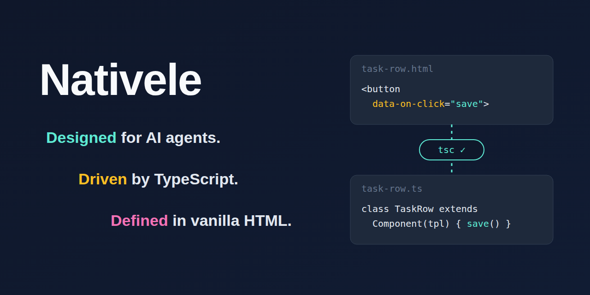

# Nativele

<p align="center"></p>

**Designed for AI agents. Driven by TypeScript. Defined in vanilla HTML.**

Nativele publishes this library as `@nativele/ts-dom` (import it from `@nativele/ts-dom`); its command line tool is `ts-dom`.

A lightweight library for building web components: HTML describes the structure and where data goes, TypeScript owns behavior and state, and the native DOM renders it, with no virtual DOM and no template expressions. It is built for type safety and for working with AI agents: `tsc` checks every name the HTML uses, and every diagnostic says how to fix it. Complex UI is built by composing native custom elements.

**Nativele is made for AI coding agents.** An agent writes a template and a class, runs `ts-dom check`, and corrects its own mistakes from the type errors: a name the HTML uses that the class does not have, an event handler that does not exist, list items of the wrong shape. There is no template language to learn and no hidden reactivity to reason about, so what the agent reads in the HTML and the class is all that happens. Every diagnostic from `ts-dom gen` and `ts-dom lint` names its rule and ends with a `Fix:` hint the agent can apply, [`llms.txt`](llms.txt) describes the whole API on one page, and [Nativele Skills](#nativele-skills) give agents verified procedures for building components and for using them with other tools.

English | [繁體中文](README.zh-TW.md)

```html
<!-- user-card.html: HTML only describes structure, where data goes, and which method handles an event -->
<h2>Hello, {{ name }}!</h2>
<button type="button" data-on-click="rename">Rename</button>
<p data-if="admin">Admin</p>
```

```ts
import { Component, define } from "@nativele/ts-dom";
import tpl from "./user-card.html.js"; // generated by ts-dom gen, fully typed

class UserCard extends Component(tpl, {
  state: { name: "Ada", admin: true }, // data lives only here; {{ name }} and data-if="admin" bind to the same-named fields automatically
}) {
  rename() {
    this.set({ name: "Grace" }); // the only entry point for changing data; the view updates automatically
  }
}
define("user-card", UserCard);
```

If the HTML uses a name that `state` does not have, or `data-on-click` points to a method that does not exist, `tsc` reports an error.

## The Short Version

Six things cover most components:

1. **HTML only names things**: `{{ name }}` (text), `data-ref="x"` (an element you need), `data-if="x"` (shown or not), `<template data-each="x">` (a list), `data-on-click="method"` (an event), `<slot>`. There are no expressions; compute in TypeScript.
2. **Run `npx ts-dom gen` before `tsc`** whenever a `.html` changes. It writes the typed `x.html.ts` that `import tpl from "./x.html.js"` needs; until then `tsc` can only say the module is missing.
3. **Data lives in the class**: `state` (yours), `props` (the parent's), `derive` (computed). Change state only with `this.set()`; `{{ }}` and `data-if` with the same name update by themselves.
4. **Everything else goes in `render(view, changed)`**: lists, attributes, focus. A list of components is one assignment, `if (changed.has("todos")) this.lists.todos.items = view.todos`, with `data-key` and `data-prop` on its `<template data-each>`.
5. **Props go down, events go up**: the parent sets props; the child calls `this.emit("name", detail)` and the parent handles it with `data-on-name` on the child's tag.
6. **A handler is a public method** `(event, hit)`; inside a list item `hit.key` is the item's key.

## Nativele Skills

Nativele ships Skills with the package: task procedures for coding agents, each with set-up steps, a complete example, known limitations, the commands that verify the result, and the exact versions it was verified with. The guides hold the facts about the API; a Skill tells an agent how to do a job with them.

```sh
npx ts-dom skills                      # list the Skills in the installed version
npx ts-dom skills nativele-core        # print one
npx ts-dom skills add nativele-core    # copy it into .claude/skills/ (when the project has .claude) or .agents/skills/
```

`npx ts-dom doctor` reads your `package.json` and suggests the Skills that match it, for example `nativele-react` when React is a dependency.

| Skill | Covers |
|---|---|
| `nativele-core` | building components: the `ts-dom check` loop, templates, state, lists, data flow |
| `nativele-react` | Nativele components in React 19: props, events, children and slots, lifecycle, TSX types |
| `nativele-vue` | Nativele components in Vue 3: props, events, `v-model`, slots, `<KeepAlive>`, template types |
| `nativele-svelte` | Nativele components in Svelte 5: props, events, slots, template types |
| `nativele-angular` | Nativele components in Angular: bindings, change detection, the build, content projection |
| `nativele-architecture` | app layout: feature folders, shared components and stores, pages mounted by a router, lazy pages, the test split |
| `nativele-vite` | Nativele in a Vite app: the plugin and `root`, multi-page builds, hot updates |
| `nativele-integration` | Nativele components in a framework without its own Skill (Preact, Solid, ...): properties, events, slots, lifecycle, template types |
| `nativele-state-management` | where state lives; `createStore`, and Zustand, Redux Toolkit or nanostores through `bind` |
| `nativele-testing` | component tests with Vitest, real-browser tests |
| `nativele-tanstack-query` | data fetching with `@tanstack/query-core` |
| `nativele-zod` | form validation with Zod or Valibot |
| `nativele-tailwind` | Tailwind CSS in templates and Shadow DOM |
| `nativele-web-awesome` | Web Awesome components in templates: typed events, forms, Light and Shadow DOM |
| `nativele-typescript` | the tsconfig: what Nativele needs, stricter options, the generated files in the type check |
| `nativele-linting` | the Nativele lint rules in oxlint, Vite+ or ESLint: rules, severities, ignore lists |
| `nativele-formatting` | oxfmt, Prettier or `vp fmt` with templates: the whitespace mode, keeping the formatter off the generated files |
| `nativele-ci` | the Nativele steps in CI: generating first, committed or ignored generated files, exit codes |
| `nativele-monorepo` | Nativele across the packages of a workspace: a shared component package, build order |

Tiers: Official Skills are verified through agent trials and maintained by the maintainers; Community Skills are contributed and show their author and last verified versions; Experimental Skills are not fully verified yet. `ts-dom skills` marks a Skill as stale when its verification is more than six months old or does not cover the installed version.

Nativele stays a light UI layer and grows its integrations through Skills: a new Skill changes no runtime code and adds no dependency. The planned Skills and how to contribute one are in [the Skills guide](https://github.com/Pixmi/nativele/blob/main/skills/README.md).

If your agent does not load Skills, add this line to its instructions (`AGENTS.md`, `CLAUDE.md` or similar): "Before working on Nativele components, run `npx ts-dom skills nativele-core` and follow it."

## Quick Start

```sh
npm i -D typescript && npm i @nativele/ts-dom
npx ts-dom gen      # generate x.html.ts (fully typed) for every x.html; run it again after every .html change
npx tsc             # type-check and compile; no Vite or other bundler needed
```

The two examples below are real, runnable files in `examples/readme/` (type-checked, linted, and tested).

### Example 1: Counter (state, derived values, events, data-if)

The HTML only describes the structure, where data goes, and which method handles an event:

```html
<p>Count: {{ count }} (double: {{ double }})</p>
<button type="button" data-on-click="inc">+1</button>
<button type="button" data-on-click="reset">Reset</button>
<p data-if="big">That is a lot of clicks!</p>
```

TypeScript owns the data and behavior. `{{ count }}`, `{{ double }}`, and `data-if="big"` bind automatically to the same-named state or derived value, and data is changed only through `this.set()`:

```ts
import { Component, define } from "@nativele/ts-dom";
import tpl from "./counter.html.js";

export class MyCounter extends Component(tpl, {
  state: { count: 0 },
  derive: { double: (s) => s.count * 2, big: (s) => s.count >= 10 },
}) {
  inc(): void {
    this.set((s) => ({ count: s.count + 1 }));
  }
  reset(): void {
    this.set({ count: 0 });
  }
}
define("my-counter", MyCounter);
```

If the HTML uses a name that neither `state` nor `derive` has, or `data-on-click` points to a method that does not exist, `tsc` reports an error.

### Example 2: A list of components (`items =`, props down, events up)

When an item has anything of its own (state, events, a nested list), make it a component and fill the list with one assignment. The item component receives its task as a prop and sends changes up as events:

```html
<!-- task-row.html -->
<label><input type="checkbox" data-ref="done" data-on-change="toggle" /> {{ title }}</label>
<button type="button" data-on-click="drop">Remove</button>
```

```ts
// task-row.ts
import { Component, define, event } from "@nativele/ts-dom";
import tpl from "./task-row.html.js";

export interface Task {
  id: number;
  title: string;
  done: boolean;
}

/** One item of the list: it receives its task as a prop and asks the parent for changes through events. */
export class TaskRow extends Component(tpl, {
  props: { task: null as Task | null },
  derive: { title: (s) => s.task?.title ?? "" },
  emits: { "task-toggle": event(), "task-remove": event() },
}) {
  override render(view: { task: Task | null }): void {
    const done = view.task?.done ?? false;
    if (this.refs.done.checked !== done) this.refs.done.checked = done;
  }
  toggle(): void {
    this.emit("task-toggle");
  }
  drop(): void {
    this.emit("task-remove");
  }
}
define("task-row", TaskRow);
```

The parent names, on the `<template data-each>`, the field that identifies an item (`data-key`) and the prop that receives it (`data-prop`), and assigns the whole list in `render`:

```html
<!-- task-board.html -->
<form data-on-submit="add">
  <input data-ref="title" aria-label="New task" />
  <button type="submit">Add</button>
</form>
<button type="button" data-on-click="sortByTitle">Sort by title</button>
<ul>
  <template data-each="tasks" data-key="id" data-prop="task">
    <task-row role="listitem" data-on-task-toggle="toggleTask" data-on-task-remove="removeTask"></task-row>
  </template>
</ul>
```

```ts
// task-board.ts
import { Component, define } from "@nativele/ts-dom";
import type { EventHit } from "@nativele/ts-dom";
import type { Task } from "./task-row.js";
import tpl from "./task-board.html.js";

export class TaskBoard extends Component(tpl, { state: { tasks: [] as Task[], nextId: 1 } }) {
  add(e: Event): void {
    e.preventDefault();
    const title = this.refs.title.value.trim();
    if (!title) return;
    this.set((s) => ({ tasks: [...s.tasks, { id: s.nextId, title, done: false }], nextId: s.nextId + 1 }));
    this.refs.title.value = "";
  }
  // A changed task is a new object: the list sets the prop only on items that are not the same object as before.
  toggleTask(_e: Event, hit: EventHit<Task, "id">): void {
    this.set((s) => ({ tasks: s.tasks.map((t) => (t.id === hit.key ? { ...t, done: !t.done } : t)) }));
  }
  removeTask(_e: Event, hit: EventHit<Task, "id">): void {
    this.set((s) => ({ tasks: s.tasks.filter((t) => t.id !== hit.key) }));
  }
  sortByTitle(): void {
    this.set((s) => ({ tasks: [...s.tasks].sort((a, b) => a.title.localeCompare(b.title)) }));
  }
  override render(view: { tasks: readonly Task[] }, changed: ReadonlySet<"tasks">): void {
    if (changed.has("tasks")) this.lists.tasks.items = view.tasks;
  }
}
define("task-board", TaskBoard);
```

Adding, removing, sorting and toggling all go through `this.set()`; the list keeps the element of each task that stays (so a checkbox keeps its focus), creates one for a new task, removes the ones that are gone, and sets `task` only on items that are a new object. `tsc` checks that the assigned items match the `task` prop of `<task-row>` and have an `id`.

## Examples

- [examples/signup](examples/signup/signup-form.ts): a signup form. Three components composed (`signup-form` → `form-field`, `entry-row`), covering `props` down, `emits` up, child components inside lists (`hit.key`), `derive` validation, and form input without cursor jumps; the corresponding real Chrome test is in [browser/signup.test.ts](browser/signup.test.ts).
- [examples/user-card](examples/user-card.ts): the minimal example, covering `state` automatic binding, `data-on-click`, lists, and slots.
- [examples/todo](examples/todo/todo-app.ts): a complete todo list, covering `state` and `derive`, `data-on-*` event delegation (including `hit.key` for list items), filtering, an empty state, `aria-pressed`, and `skipUnchanged`; it has a corresponding real Chrome end-to-end test ([browser/todo.test.ts](browser/todo.test.ts)).
- [examples/recipes](examples/recipes/contact-app.ts): a contacts screen for the [Recipes](https://github.com/Pixmi/nativele/blob/main/docs/recipes.md) guide, covering loading and error states from a shared store, a filtered list, a modal dialog with form validation, and typed `hit.key`; its real Chrome test is [browser/recipes.test.ts](browser/recipes.test.ts).

## Documentation

The full guide is in English:

- [Templates: HTML syntax, generated types, templates without a component, Trusted Types, translations and icons](https://github.com/Pixmi/nativele/blob/main/docs/templates.md)
- [Components and data flow: state, props, derive, events, composition, stores](https://github.com/Pixmi/nativele/blob/main/docs/components.md)
- [Recipes: loading and error states, store data, filtered lists, dialogs, form validation](https://github.com/Pixmi/nativele/blob/main/docs/recipes.md)
- [Lists: lists of components with `items =`, plain lists with `replace()`, moving items](https://github.com/Pixmi/nativele/blob/main/docs/lists.md)
- [Architecture: feature folders, shared components and stores, pages mounted by a router, where state lives, testing strategy](https://github.com/Pixmi/nativele/blob/main/docs/architecture.md)
- [Setup, checks and lint: installation, Vite, oxlint, `ts-dom check`, `ts-dom doctor`, accessibility](https://github.com/Pixmi/nativele/blob/main/docs/tooling.md)
- [Performance: the large list benchmark](https://github.com/Pixmi/nativele/blob/main/docs/performance.md)
- [Design: principles, deliberate decisions, limitations](https://github.com/Pixmi/nativele/blob/main/docs/design.md)
- [Developing Nativele: project structure, tests](https://github.com/Pixmi/nativele/blob/main/docs/contributing.md)
