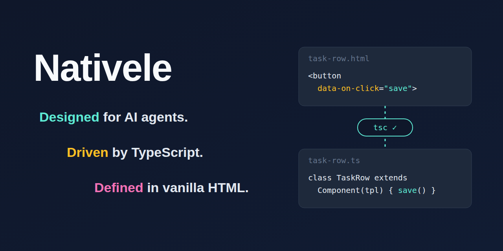

# Nativele

<p align="center"></p>

**為 AI agent 設計，由 TypeScript 驅動，以原生 HTML 定義。**

Nativele 以 `@nativele/ts-dom` 發布這個函式庫（從 `@nativele/ts-dom` 匯入），命令列工具是 `ts-dom`。

[English](README.md) | 繁體中文

用來建構 Web Components 的輕量函式庫：HTML 描述結構與資料要放的位置，TypeScript 負責行為與狀態，由原生 DOM 渲染，沒有虛擬 DOM，也沒有範本表達式。它為型別安全與 AI agent 協作而設計：`tsc` 會檢查 HTML 用到的每個名稱，每則診斷都說明怎麼修。複雜的介面以原生自訂元素組合而成。

**Nativele 是為 AI coding agent 打造的。** agent 寫好範本與類別，執行 `ts-dom check`，就能從型別錯誤自行修正：HTML 用了類別沒有的名稱、事件處理方法不存在、清單項目的形狀不對。沒有要另外學的範本語言，也沒有要推敲的隱式響應式，agent 在 HTML 與類別裡讀到的就是實際發生的全部。`ts-dom gen` 與 `ts-dom lint` 的每則診斷都標明規則並附上可直接套用的 `Fix:` 提示，[`llms.txt`](llms.txt) 用一頁說明整個 API，[Nativele Skills](#nativele-skills) 則提供 agent 經過驗證的流程，用於開發元件以及與其他工具整合。

```html
<!-- user-card.html：HTML 只描述結構、資料要放的位置、事件要找哪個方法 -->
<h2>Hello, {{ name }}!</h2>
<button type="button" data-on-click="rename">改名</button>
<p data-if="admin">管理員</p>
```

```ts
import { Component, define } from "@nativele/ts-dom";
import tpl from "./user-card.html.js"; // 由 ts-dom gen 產生，含型別

class UserCard extends Component(tpl, {
  state: { name: "Ada", admin: true }, // 資料只在這裡；{{ name }}、data-if="admin" 自動對應同名欄位
}) {
  rename() {
    this.set({ name: "Grace" }); // 唯一改資料的入口，畫面自動更新
  }
}
define("user-card", UserCard);
```

HTML 用了 `state` 沒有的名稱、`data-on-click` 指向不存在的方法，`tsc` 都會報錯。

## 精簡版

六件事涵蓋大多數元件：

1. **HTML 只放名稱**：`{{ name }}`（文字）、`data-ref="x"`（需要用到的元素）、`data-if="x"`（顯示與否）、`<template data-each="x">`（清單）、`data-on-click="method"`（事件）、`<slot>`。沒有表達式，需要計算就在 TypeScript 做。
2. **`.html` 有改動就先跑 `npx ts-dom gen` 再跑 `tsc`**：它會產生 `import tpl from "./x.html.js"` 需要的型別檔 `x.html.ts`；在那之前 `tsc` 只會告訴你找不到模組。
3. **資料放在類別裡**：`state`（自己的）、`props`（父元件給的）、`derive`（算出來的）。state 只用 `this.set()` 改；同名的 `{{ }}` 與 `data-if` 會自己更新。
4. **其他都寫在 `render(view, changed)`**：清單、屬性、焦點。元件組成的清單只要一次指派，`if (changed.has("todos")) this.lists.todos.items = view.todos`，並在 `<template data-each>` 上寫 `data-key` 與 `data-prop`。
5. **props 往下、事件往上**：父元件設定 props；子元件呼叫 `this.emit("name", detail)`，父元件在子元件的標籤上用 `data-on-name` 處理。
6. **處理方法是公開方法** `(event, hit)`；在清單項目內 `hit.key` 就是該項目的 key。

## Nativele Skills

Nativele 隨套件提供 Skill：給 coding agent 的任務流程，每份都有設定步驟、完整範例、已知限制、驗證結果的指令，以及驗證時使用的確切版本。API 的事實寫在指南裡；Skill 告訴 agent 怎麼用它們完成一件工作。

```sh
npx ts-dom skills                      # 列出已安裝版本提供的 Skill
npx ts-dom skills nativele-core        # 顯示其中一份
npx ts-dom skills add nativele-core    # 複製到 .claude/skills/（專案有 .claude 時）或 .agents/skills/
```

`npx ts-dom doctor` 會讀取你的 `package.json` 並建議相符的 Skill，例如相依 React 時建議 `nativele-react`。

| Skill | 內容 |
|---|---|
| `nativele-core` | 開發元件：`ts-dom check` 循環、範本、state、清單、資料流 |
| `nativele-react` | 在 React 19 中使用 Nativele 元件：props、事件、子元素與 slot、生命週期、TSX 型別 |

等級：Official 由維護者以 CI 中的範例專案驗證；Community 由社群貢獻，標示作者與最後驗證版本；Experimental 尚未充分驗證。驗證超過六個月，或不涵蓋已安裝的版本時，`ts-dom skills` 會標示為可能過期。

Nativele 維持輕量的 UI 層，整合能力透過 Skill 擴展：新增 Skill 不改動執行期程式碼，也不增加依賴。規劃中的 Skill 與貢獻方式見 [Skills 指南](https://github.com/Pixmi/nativele/blob/main/skills/README.md)。

如果你的 agent 不會載入 Skill，在它的指引檔（`AGENTS.md`、`CLAUDE.md` 等）加一行：「處理 Nativele 元件前，先執行 `npx ts-dom skills nativele-core` 並照著做。」

## 快速開始

```sh
npm i -D typescript && npm i @nativele/ts-dom
npx ts-dom gen      # 為每個 x.html 產生 x.html.ts（含型別）；每次改了 .html 都要再跑一次
npx tsc             # 型別檢查並編譯；不需要 Vite 或其他 bundler
```

下面兩個範例都是 `examples/readme/` 裡真實可執行的檔案（有型別檢查、lint 與測試）。

### 範例 1：計數器（state、衍生值、事件、data-if）

HTML 只描述結構、資料放哪裡、事件找哪個方法：

```html
<p>Count: {{ count }} (double: {{ double }})</p>
<button type="button" data-on-click="inc">+1</button>
<button type="button" data-on-click="reset">Reset</button>
<p data-if="big">That is a lot of clicks!</p>
```

TypeScript 擁有資料與行為。`{{ count }}`、`{{ double }}`、`data-if="big"` 自動對應同名的 state 或衍生值，資料只用 `this.set()` 修改：

```ts
import { Component, define } from "@nativele/ts-dom";
import tpl from "./counter.html.js";

export class MyCounter extends Component(tpl, {
  state: { count: 0 },
  derive: { double: (s) => s.count * 2, big: (s) => s.count >= 10 },
}) {
  inc(): void {
    this.set((s) => ({ count: s.count + 1 }));
  }
  reset(): void {
    this.set({ count: 0 });
  }
}
define("my-counter", MyCounter);
```

HTML 用了 `state` 與 `derive` 都沒有的名稱、`data-on-click` 指向不存在的方法，`tsc` 都會報錯。

### 範例 2：元件組成的清單（`items =`、props 往下、事件往上）

項目有自己的東西（狀態、事件、內層清單）時，就把它做成元件，整份清單用一次指派填入。項目元件以 prop 接收自己的 task，用事件把變更往上送：

```html
<!-- task-row.html -->
<label><input type="checkbox" data-ref="done" data-on-change="toggle" /> {{ title }}</label>
<button type="button" data-on-click="drop">Remove</button>
```

```ts
// task-row.ts
import { Component, define, event } from "@nativele/ts-dom";
import tpl from "./task-row.html.js";

export interface Task {
  id: number;
  title: string;
  done: boolean;
}

/** One item of the list: it receives its task as a prop and asks the parent for changes through events. */
export class TaskRow extends Component(tpl, {
  props: { task: null as Task | null },
  derive: { title: (s) => s.task?.title ?? "" },
  emits: { "task-toggle": event(), "task-remove": event() },
}) {
  override render(view: { task: Task | null }): void {
    const done = view.task?.done ?? false;
    if (this.refs.done.checked !== done) this.refs.done.checked = done;
  }
  toggle(): void {
    this.emit("task-toggle");
  }
  drop(): void {
    this.emit("task-remove");
  }
}
define("task-row", TaskRow);
```

父元件在 `<template data-each>` 上寫出識別項目的欄位（`data-key`）與接收項目的 prop（`data-prop`），在 `render` 裡指派整份清單：

```html
<!-- task-board.html -->
<form data-on-submit="add">
  <input data-ref="title" aria-label="New task" />
  <button type="submit">Add</button>
</form>
<button type="button" data-on-click="sortByTitle">Sort by title</button>
<ul>
  <template data-each="tasks" data-key="id" data-prop="task">
    <task-row role="listitem" data-on-task-toggle="toggleTask" data-on-task-remove="removeTask"></task-row>
  </template>
</ul>
```

```ts
// task-board.ts
import { Component, define } from "@nativele/ts-dom";
import type { EventHit } from "@nativele/ts-dom";
import type { Task } from "./task-row.js";
import tpl from "./task-board.html.js";

export class TaskBoard extends Component(tpl, { state: { tasks: [] as Task[], nextId: 1 } }) {
  add(e: Event): void {
    e.preventDefault();
    const title = this.refs.title.value.trim();
    if (!title) return;
    this.set((s) => ({ tasks: [...s.tasks, { id: s.nextId, title, done: false }], nextId: s.nextId + 1 }));
    this.refs.title.value = "";
  }
  // A changed task is a new object: the list sets the prop only on items that are not the same object as before.
  toggleTask(_e: Event, hit: EventHit<Task, "id">): void {
    this.set((s) => ({ tasks: s.tasks.map((t) => (t.id === hit.key ? { ...t, done: !t.done } : t)) }));
  }
  removeTask(_e: Event, hit: EventHit<Task, "id">): void {
    this.set((s) => ({ tasks: s.tasks.filter((t) => t.id !== hit.key) }));
  }
  sortByTitle(): void {
    this.set((s) => ({ tasks: [...s.tasks].sort((a, b) => a.title.localeCompare(b.title)) }));
  }
  override render(view: { tasks: readonly Task[] }, changed: ReadonlySet<"tasks">): void {
    if (changed.has("tasks")) this.lists.tasks.items = view.tasks;
  }
}
define("task-board", TaskBoard);
```

新增、刪除、排序與切換都透過 `this.set()`；清單會保留還在的 task 的元素（所以核取方塊的焦點不會丟）、為新的 task 建立元素、移除消失的，並只對換成新物件的項目設定 `task`。`tsc` 會檢查指派的項目是否符合 `<task-row>` 的 `task` prop 並帶有 `id`。

## 範例

- [examples/signup](examples/signup/signup-form.ts)：註冊表單。三個元件組合（`signup-form` → `form-field`、`entry-row`），涵蓋 `props` 往下、`emits` 往上、清單內的子元件（`hit.key`）、`derive` 驗證、表單輸入不跳游標；對應的真實 Chrome 測試在 [browser/signup.test.ts](browser/signup.test.ts)。
- [examples/user-card](examples/user-card.ts)：最小範例，涵蓋 `state` 自動綁定、`data-on-click`、清單、slot。
- [examples/todo](examples/todo/todo-app.ts)：完整的待辦清單，涵蓋 `state` 與 `derive`、`data-on-*` 事件委派（含清單項目的 `hit.key`）、篩選、空狀態、`aria-pressed`、`skipUnchanged`；有對應的真實 Chrome 端對端測試（[browser/todo.test.ts](browser/todo.test.ts)）。
- [examples/recipes](examples/recipes/contact-app.ts)：[Recipes](https://github.com/Pixmi/nativele/blob/main/docs/recipes.md) 指南使用的聯絡人畫面，涵蓋共用 store 的載入與錯誤狀態、篩選清單、帶表單驗證的對話框，以及有型別的 `hit.key`；對應的真實 Chrome 測試是 [browser/recipes.test.ts](browser/recipes.test.ts)。

## 文件

完整的指南只有英文版（可以用瀏覽器的翻譯功能閱讀）：

- [Templates: HTML syntax, generated types, templates without a component, Trusted Types, translations and icons](https://github.com/Pixmi/nativele/blob/main/docs/templates.md)
- [Components and data flow: state, props, derive, events, composition, stores](https://github.com/Pixmi/nativele/blob/main/docs/components.md)
- [Recipes: loading and error states, store data, filtered lists, dialogs, form validation](https://github.com/Pixmi/nativele/blob/main/docs/recipes.md)
- [Lists: lists of components with `items =`, plain lists with `replace()`, moving items](https://github.com/Pixmi/nativele/blob/main/docs/lists.md)
- [Setup, checks and lint: installation, Vite, oxlint, `ts-dom check`, `ts-dom doctor`, accessibility](https://github.com/Pixmi/nativele/blob/main/docs/tooling.md)
- [Performance: the large list benchmark](https://github.com/Pixmi/nativele/blob/main/docs/performance.md)
- [Design: principles, deliberate decisions, limitations](https://github.com/Pixmi/nativele/blob/main/docs/design.md)
- [Developing Nativele: project structure, tests](https://github.com/Pixmi/nativele/blob/main/docs/contributing.md)
